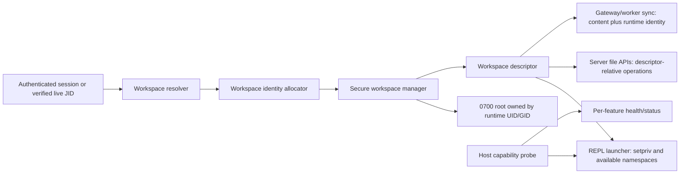

# OpenREPL Workspace and Sandbox Isolation

## High-level design proposal

**Status:** Initial implementation completed; deployment validation and rollout remain.

## 1. Goal

Prevent code running in one REPL workspace from reading or changing another user's workspace, including through child processes and server-side file APIs. Preserve forked tabs and shared REPLs as views of the same live session. Apply namespaces and resource controls that the host actually permits, and report unavailable controls instead of treating them as enabled.

The guarantee for home-directory isolation comes from Linux filesystem ownership and mode bits. Namespaces and cgroups are additional, independent sandbox and resource controls. They must not be treated as a substitute for workspace permissions.

## 2. Current behavior and gaps

The implementation today has these relevant properties:

- `containers.NewContainer` creates a fixed set of namespaces and a cgroup v1 memory group as one setup path. If the cgroup setup fails, the language is absent from `Containers`, and process namespace attributes are not added either.
- `containers.InitContainers` creates `/tmp/home` and language directories with mode `0777`.
- REPL commands inherit the service's host UID/GID. Their working directory and `HOME` vary by workspace, but the kernel does not distinguish one workspace owner from another.
- The terminal path resolves sessions and fork JIDs, and the gateway routes shared workspace requests. This is a useful basis for preserving same-process sharing.
- File-browser and upload/save paths still use ordinary path-based filesystem operations. Workspace sync (`src/wsync/home_linux.go`) already has a stronger Linux implementation: directory-descriptor-relative operations that reject traversal through symlinks.
- Workspace sync copies contents, modes, and timestamps but has no runtime UID/GID ownership metadata.

Consequently, directory naming and `$HOME` alone do not isolate hostile REPL code. The current `0777` parent also allows listing and creating entries directly beneath `/tmp/home`.

## 3. Security invariants

1. Every independent workspace has one runtime UID/GID identity on a host. Different workspaces never share that identity while either workspace is live.
2. Every workspace root is owned by its runtime UID/GID and has mode `0700`. `/tmp/home` is service-owned and mode `0711`; users can traverse to a known workspace but cannot list or create siblings.
3. REPL processes start with their workspace UID/GID, no supplementary groups, no inherited or ambient capabilities, `no_new_privs`, and `umask 077`.
4. A forked tab joining a live process uses that process's UID/GID and workspace. It cannot choose another identity or home by supplying a PID, JID, or path that is not verified as live and authorized.
5. A shared REPL resolves to the owner's live JID and existing workspace. A collaborator does not start another process or receive a separate workspace identity for that shared session.
6. All server-side file operations resolve a workspace from authenticated session state or a verified live JID, then operate relative to an opened workspace root. User-controlled paths cannot escape through `..`, absolute paths, or symlinks.
7. Gateway and worker copies of one workspace retain the same runtime UID/GID and secure root mode. Sync peers cannot choose or overwrite another workspace's identity metadata.
8. A missing namespace or cgroup feature does not disable other available features. The admin status reports each applied, unavailable, or failed feature accurately.

## 4. Architecture



### 4.1 Workspace identity registry

Introduce a `WorkspaceIdentity` record with at least:

```text
workspace key -> runtime uid, runtime gid, identity generation, lifecycle state
```

The workspace key is derived only from trusted identity resolution:

- Signed-in user: stable authenticated account ID, mapped persistently to one runtime UID/GID.
- Guest: a generated guest workspace ID, mapped for the lifetime of that workspace. Do not derive host IDs directly from a public cookie or accept IDs supplied by a client.
- Fork/shared session: resolve the verified live JID to its owning workspace and reuse that workspace identity.

Allocate IDs from an explicitly reserved range that does not overlap service, system, or host users. Persist the mapping so restarts and signed-in sessions are stable. Guest ID reuse is delayed until cleanup has removed all files and processes; increment a generation or otherwise prevent a stale process/session from inheriting a recycled identity.

In distributed mode, the gateway is the identity authority. It sends the worker an authenticated workspace key plus UID/GID and generation when preparing a home. The worker validates the message against the authenticated tunnel and its workspace ownership registry. Sync messages carry this metadata as a home-level attribute, not as client-controlled file entries. A node must not start a REPL until its local home ownership and identity metadata agree with the gateway.

### 4.2 Secure workspace manager

Replace language-specific homes and broad `MkdirAll(..., 0777)` setup with a single workspace manager. It owns `/tmp/home`, verifies it is a real directory and not a symlink, and enforces mode `0711`. It creates each workspace root atomically with mode `0700`, then sets owner UID/GID before exposing the workspace to the launcher. Existing directories are reconciled only after checking their expected path, owner, and type; unexpected ownership or symlinks fail closed and are logged for operator repair.

Creation and cleanup run under a service authority that can `chown` to the allocated ID. Keep sync state, identity records, and service metadata outside user-visible workspace roots. On cleanup, stop/reap all processes using the workspace before removing the home and releasing guest IDs.

### 4.3 Per-feature sandbox capability discovery

At startup, probe capabilities by attempting the actual operation in a short-lived helper process under the same effective user, container, mount configuration, and seccomp policy as REPL launch. Inspecting capability bits alone is insufficient: a namespace clone or cgroup write can still be denied by the runtime.

Record a capability profile, for example:

```text
user namespace: available/unavailable
UTS, PID, mount, network namespaces: available/unavailable individually
cgroup memory controller: available/unavailable
workspace UID switching: available/unavailable
```

For each REPL, construct launch attributes from the successful profile. Probe namespace combinations as needed because some namespaces depend on `CLONE_NEWUSER` or other setup; do not infer support for one from another. Create the process with only supported flags, and fail that feature explicitly if process creation reports a runtime denial. Cgroup setup is separate: detect cgroup v1/v2 and the delegated controllers, then apply only supported limits. A missing cgroup must not clear working namespace flags; a missing namespace must not disable a functioning memory limit.

Do not silently claim filesystem isolation from a mount namespace alone. Until OpenREPL mounts a restricted filesystem or changes the root, a new mount namespace still exposes the host/container filesystem subject to ordinary DAC permissions.

### 4.4 Launcher and the unprivileged deployment constraint

Launch user code through a dedicated launcher path. Before executing the REPL, set the target UID/GID, clear supplementary groups, clear capability sets, enable `no_new_privs`, set `umask 077`, set `HOME` to the workspace, and set the working directory. Prefer a small, audited launcher or a carefully constructed `setpriv` invocation with absolute paths and fixed arguments. Never interpolate user-provided strings into the launcher command line.

There is an important Linux constraint: a process cannot use `setpriv` to switch to arbitrary host UIDs unless it has the needed privilege (`CAP_SETUID`/`CAP_SETGID`, commonly root) or a suitable delegated user-namespace/subuid arrangement. An unprivileged deployment can opportunistically use user namespaces, but it cannot be assumed to provide distinct host filesystem identities. Therefore:

- If the service has a configured delegated UID/GID range and can create mappings for each workspace, run with per-workspace mapped identities and verify the mapping at startup.
- Otherwise, if the service has permission to switch to reserved host UIDs, use `setpriv` in the host user namespace, dropping privilege before user code starts.
- If neither mechanism works, mark `workspace UID isolation` unavailable. Strict isolation mode must refuse to start untrusted REPLs; compatibility mode may run with a clear degraded security status only if the operator explicitly configures that policy.

This separation satisfies “apply only options that work” for optional namespaces and resource limits, while making the non-optional home-isolation guarantee honest. DAC isolation cannot be provided by merely setting directory modes if all REPLs still run as the same UID.

### 4.5 Identity and fork lifecycle

Add a trusted resolver returning `{workspace key, root, runtime uid, runtime gid, generation, owner node}`. All terminal, fork, file, upload, compile/run, and shared-session paths consume this object instead of independently trusting a `homedir` parameter.

Maintain a live-process registry keyed by PID/JID with workspace key, identity generation, and owner node. Register only after successful process start and remove only after reaping. Validate fork JIDs against this registry and current session authorization; do not use cgroup membership as the sole liveness check because cgroups may be unavailable. Fork launch joins the existing process's workspace and identity. It must not allocate a new UID/GID.

For Firebase collaboration, continue using the existing collaboration stream to discover the owner's current signed JID, then resolve that JID through the authenticated gateway route. Treat the JID as a reference to a live session, not as authorization by itself. If it is stale or no longer authorized, reject the shared operation.

### 4.6 Server-side file operations

Create a workspace-scoped file API based on an already-open root directory descriptor. On Linux, use `openat2` with `RESOLVE_BENEATH` and `RESOLVE_NO_SYMLINKS` where supported, with the existing component-by-component `openat`/`O_NOFOLLOW` approach from `wsync/home_linux.go` as the portable Linux fallback. Apply it to tree listing, read/download, create, save, upload, delete, rename, unzip/extract, and quota scanning. Avoid prefix checks such as `strings.HasPrefix(path, homedir)`, which do not establish a safe path boundary.

The server may perform these operations as a privileged service, but it must first resolve the trusted workspace and then use only descriptor-relative paths below that workspace. Create regular files with mode `0600` (or requested mode masked by a restrictive policy), directories `0700`, and explicitly set workspace UID/GID on created entries. Reject special files and do not follow a user-created symlink during API operations. Keep service metadata and uploads temporary files within the same workspace filesystem, with unpredictable names and atomic rename.

### 4.7 Workspace sync

Extend the home attach/preparation metadata with runtime UID/GID and identity generation. Before transferring files, each side verifies that the sender is the authorized owner for that home and that the target ID falls in its configured range. On receipt, write safely using the existing descriptor-relative `Home` implementation, then set the agreed owner/group and restrictive modes. Do not trust ownership from per-file entries; the home-level identity is authoritative.

During first rollout, reject or quarantine a sync if the two nodes cannot honor the same host IDs or the expected owner. A later design may use an explicit mapping table per node, but it must preserve the semantic identity of a workspace and must not make files readable by another REPL. Ownership changes during migration are serialized with process start and home sync.

## 5. Configuration and operational status

Add an operator policy such as:

```text
workspace_isolation = required | best_effort
runtime_uid_range = <reserved range or delegated range>
```

`required` refuses REPL admission when distinct runtime IDs and ownership setup are unavailable. `best_effort` permits operation only with a prominent degraded status and log event; it must never report the workspace as isolated.

Admin health should report separate rows for workspace UID isolation, each namespace, and each resource controller. For each language/session, logs should show a concise applied feature set and any unavailable optional feature. Do not label a REPL “sandboxed” as one binary state when only some controls are active.

## 6. Rollout plan

1. **Inventory and status:** implement real launch probes and per-feature reporting without changing behavior. Identify deployment UID/GID capabilities and cgroup v1/v2 support.
2. **Identity and directory ownership:** add the persistent workspace ID registry, secure root manager, root `0711`, workspace `0700`, and cleanup/recovery logic. Add strict-mode admission checks.
3. **Launcher:** add per-workspace UID/GID drop, supplementary-group clearing, capability clearing, `no_new_privs`, and `umask 077`; retain only supported namespace and cgroup features.
4. **File API migration:** move every server-side operation to workspace-root-relative safe operations and explicit ownership. Remove path-prefix authorization.
5. **Fork and sharing:** carry identity in the live JID registry, verify authorization, and reuse parent identity. Validate shared REPL routes against the owner's live JID.
6. **Distributed sync:** add authenticated home identity metadata, ownership-safe reconciliation, and rollout checks on gateway and workers.
7. **Migration:** inspect existing homes, assign stable identities, chown roots and contents under service control, tighten modes, and report collisions or symlinks for repair before enabling required mode.

Each phase should be independently deployable and observable. Do not enable strict mode on a node until its UID strategy, file APIs, fork handling, and (when applicable) gateway/worker sync all honor the same workspace identity.

## 7. Acceptance criteria

- Two different REPL workspaces have distinct effective host IDs or distinct verified host mappings; one cannot list, read, write, rename, or delete the other's workspace.
- A REPL cannot enumerate `/tmp/home` or create a sibling workspace entry.
- Files created by shell code, compile/run, uploads, file APIs, and workspace sync remain owned by the correct runtime UID/GID and private by default.
- An unsupported namespace or cgroup feature is omitted independently while supported features remain active and visible in health status.
- A deployment lacking UID switching/mapping reports workspace isolation unavailable; required mode rejects REPL admission.
- A forked tab and a Firebase shared session use the live owner's workspace identity and process; a stale or forged JID is rejected.
- Attempts to escape via absolute paths, `..`, symlink swaps, symlinked roots, or cross-workspace paths fail without modifying files outside the resolved home.
- Gateway and worker copies retain one workspace identity through initial sync, reconnect, relocation, and guest cleanup; an ID is not reused while any old process or copy can still exist.
