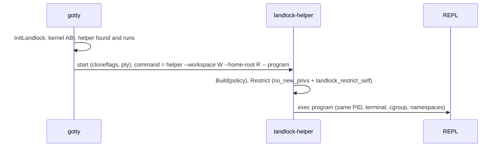

# LLD 14: Filesystem sandbox of the REPLs (Landlock)

Scope: `src/landlock`, `src/landlockhelper`, `src/containers/landlock.go`, the launch in `src/backend/localcommand/local_command.go`, `src/containers/dumpable_*.go`, `src/utils/sandbox_env.go` and `src/utils/tmpclean.go`, the check in `src/server/admin_health.go`, and `scripts/ci/landlock-compat.py`.

## 1. Goal and what it is not

A REPL may use its own workspace and the system's programs, and nothing else: not another user's files, not the list of workspaces, not the server's databases and not the secrets of the server.

Before this, REPLs of different users shared one filesystem and one user id; they were kept apart only by each one's working directory and `$HOME` (LLD 03). Namespaces and cgroups give separate PIDs, a loopback-only network and a memory limit, but not a separate filesystem. Landlock is that layer. It needs no privilege, so it works where the cgroup sandbox cannot (a host that refuses privileged containers, such as Render), and it stacks with the cgroup sandbox where that exists.

It is not a container. It does not limit memory, network or processes, and it does not stop one REPL from signalling another (Section 7).

## 2. How it is applied



- `InitLandlock` runs once at start (before the cgroup setup, which it does not depend on). It asks the kernel for the Landlock version, finds `landlock-helper` beside `gotty` or in the PATH, and runs `landlock-helper --probe`. Unless the mode is `off` it also marks the server **non-dumpable** (`prctl(PR_SET_DUMPABLE, 0)`): see Section 4.
- The helper (`src/landlockhelper`) is built without cgo, so it is a static program: it loads nothing the environment of a REPL could name (`LD_PRELOAD` and the like) before the policy is on. It builds the policy from the workspace and the folder of the workspaces, applies it to itself and `exec`s the program. If the policy cannot be applied it exits with status 126 and does not run the program: there is no unrestricted fallback inside the helper.
- A restriction cannot be lifted by the process, root included, and is inherited by everything it starts.
- The helper becomes the REPL (`exec`), so the PID, the terminal, the cgroup and the namespaces gotty arranged stay.
- **Forks.** The command of a forked tab is `nsenter -t… <helper> … -- program`: `nsenter` first, the helper inside the namespaces it joined. The helper sets `no_new_privs`, which would stop a setuid `nsenter` (the `.deb` makes it setuid) from joining them.

## 3. Who gets it, and the modes

### Who gets it

Every REPL of a guest or a signed-in user. **An admin's REPL gets no sandbox at all**: no Landlock, no namespaces, no memory limit (no cgroup), no per-file limit; it is only tracked so that a fork can join it. The admin owns the server and uses the REPL for what the host can do. The decision is `utils.IsUserAdmin(params)` on the `usermode` parameter, which the **server** sets: from the session cookie and the server's admin list (`OPENREPL_ADMIN_EMAILS` and the dashboard's), or, on a worker, from the gateway's trusted headers. The browser must not be able to name it: until this change the payload of the websocket's init message was merged over the server's values, so a client could have sent `usermode=admin` (or another user's `homedir` or `uid`). `launchParams` (`server/handlers.go`) now removes those three keys from the arguments and the init payload and applies the server's values last; the web client never sent them (its payload has only the IDE fields), so nothing the product uses is lost.

### Modes (`OPENREPL_LANDLOCK`)

| Mode | Kernel has Landlock | Kernel has none, or no helper |
|---|---|---|
| `auto` (default) | REPLs run under the policy | REPLs run without it; the log and the admin health page ("Filesystem sandbox") say why |
| `off` | not used | not used |
| `require` | REPLs run under the policy | a REPL does not start: `localcommand.New` returns the reason |

`auto` must never be mistaken for safe: on a kernel without Landlock the REPLs share the files of the server (the Raspberry Pi kernel has no Landlock). The health page shows a warning for it.

## 4. The policy

All filesystem rights the kernel knows (by ABI version) are handled; what no rule allows is denied. A rule on a folder covers everything below it and cannot be narrowed, so **no rule may reach the folder of the workspaces**: a folder that contains it (for example `/tmp` when the workspaces are in `/tmp/home`) gets no rule and the reason goes to the log. A rule on a file keeps only the rights that mean something for a file (the kernel refuses the others).

**Size of a file.** The helper also sets `RLIMIT_FSIZE`, soft and hard, to `utils.WorkspaceQuotaMB` (50 MB, the same constant as the file browser's quota, `filebrowser.MAXDISKUSAGE_MB`): a program that writes a bigger file gets an error (`File too large`; Python ignores `SIGXFSZ`, other programs are stopped by it) and cannot raise the limit without `CAP_SYS_RESOURCE`. It limits one file, not the total, and applies under the sandbox only.

| Path | Rights |
|---|---|
| the workspace (resolved, so a symlink cannot point at another one) | all, including making device files |
| `/tmp`, `/var/tmp`, `/dev/shm` | read, write, execute (shared by all REPLs) |
| `/usr /bin /sbin /lib /lib32 /lib64 /libx32 /etc /sys`, the tools of the image (`/root/.nvm`, `/root/.cargo`, `/root/.rustup`, `/opt/cling`, other folders of `/opt`) | read, execute |
| the sub-folders of `/opt/gotty` (not its files: the server's databases) | read, execute |
| `/dev/null /dev/zero /dev/full /dev/random /dev/urandom /dev/tty /dev/ptmx`, `/dev/pts` | read, write, ioctl |
| `/proc` | read (the process' own entry also writes). A **Debug run** (`CompilerOption=debug`, the helper is given `--debug`) may also write it: gdb writes the memory of the program it debugs through `/proc/<pid>/mem`, and without this it cannot insert a breakpoint (found by the compatibility test) |

Not allowed, among others: `/opt/openrepl` (a `.env` of a dev server), `/root` except the tool folders above, `/run`, `/var` apart from `/var/tmp`, and every other workspace and the list of them.

**Why `/proc` is open, and the server's environment is closed another way.** A Landlock rule can name a process number but not "my children". A rule for the REPL's own number only breaks every child process: `ps`, `top`, `cat /proc/self/status`, a compiled program that asks for `/proc/self/exe` (found in the compatibility test). So `/proc` is read-only for all. That would leave the server's environment, where a host such as Render keeps the secrets, readable: on an unprivileged container a REPL read `/proc/1/environ` of the server (tested, it printed the secret). The server therefore marks itself non-dumpable: the files of `/proc/<pid>` of such a process need the capability to trace it, which an ordinary container has not, and the test shows the read refused. A REPL in its own user namespace (the cgroup sandbox) cannot read it either. Between REPLs of the same user Landlock itself refuses the access that needs the right to trace a process: another REPL's environment (`/proc/<pid>/environ`), its memory (`/proc/<pid>/mem`) and `ptrace` are denied (tested on a 6.8 kernel with two sandboxed processes). That also means the write access to `/proc` of a Debug run reaches only the REPL's own descendants. What is not refused between REPLs is a signal (next).

When the workspaces are in `/tmp` (the default of a plain install) `/tmp` is closed, and the helper sets `TMPDIR`, `TMP` and `TEMP` to `<workspace>/.tmp` so that programs that follow them keep working; ones that write `/tmp` directly are refused.

The number of the process' own `/proc` entry is read from `/proc/self`, not from `getpid`: inside a PID namespace the REPL is PID 1, but the `/proc` that is mounted names it by its number outside.

## 5. The workspaces folder (`OPENREPL_HOME_DIR`)

`utils.HOME_DIR` was a constant `/tmp/home/`. It is now a variable set by `utils.InitHomeDir` from `OPENREPL_HOME_DIR`, right after the env file is loaded (the default is unchanged). A relative path, `/`, and system folders (`/tmp`, `/home`, `/etc`, `/opt`, …) are refused and the default is used with an error in the log: the server deletes below this folder and a REPL may write there. The Docker image sets `/home/openrepl/`, which keeps the workspaces out of `/tmp` so that `/tmp` can stay open to the REPLs. A gateway and its workers **must use the same folder**: the gateway sends a worker the path of the workspace.

## 6. `/tmp`

`/tmp` is open to all REPLs (as before), so what one REPL puts there is visible to the others, and the 50 MB quota of a workspace does not count it. Nothing cleans `/tmp` in a container. With `OPENREPL_TMP_MAX_AGE` (the image sets `1h`) the server looks every 10 minutes and deletes the entries of `/tmp` whose newest file is older than that (a folder that is still being written to is told by what is inside it), never `go_cache` (the shared Go build cache) and never the folder of the workspaces. The admin health page shows the free space of `/tmp`.

## 7. Known limits

- **Signals.** Landlock does not stop a signal to another process before ABI 6. From ABI 6 (Linux 6.12; Render has ABI 8) the helper asks for `LANDLOCK_SCOPE_SIGNAL`: the REPL may then signal only the processes of its own sandbox, not other REPLs and not the server (gotty is not sandboxed, so it can still signal every REPL, and closing a terminal works). It is asked for only for a REPL **without a PID namespace of its own** (no cgroup sandbox for its command): with one, the other processes are not visible, and the tabs of a fork share it, so signals between the tabs keep working. Where it is applied, a fork gets its own sandbox (a sandbox is inherited by children only and cannot be joined), so a shell of a forked tab cannot signal the processes of the primary tab. The server checks with the kernel at start that the scope is accepted (`landlock.ScopeSupported`); on a kernel that does not accept it, nothing is asked for. Abstract UNIX sockets (`LANDLOCK_SCOPE_ABSTRACT_UNIX_SOCKET`) are deliberately not scoped. Other ports, TCP, UDP, WebSockets and file UNIX sockets are not affected by any of this.
- **Sharing.** A shared collaboration link (`/#<id>`) opens a viewer page that never connects to the server: its keystrokes are relayed through Firebase into the **owner's** websocket, so the collaborator types into the owner's REPL with the owner's sandbox. A shared **admin** terminal is therefore an unsandboxed shell. A fork link (`?jid=`) opens another terminal on the same workspace.
- **Metadata.** `chmod`, `chown` and timestamps of another workspace's files are not covered by Landlock. No seccomp filter is added: it would stop `chmod +x` in the user's own workspace.
- **Network** is not restricted. Landlock restricts TCP by port only, not by address, which does not fit a playground that runs socket programs.
- **Shared `/tmp`**: see Section 6.
- **No Landlock on the Raspberry Pi** kernel (`ENOSYS`): `auto` runs without it there and the cgroup sandbox applies.
- **An amd64 container on an arm64 host** (the dev container under Rosetta, a worker under qemu-user): the emulator does not pass the Landlock system calls to the kernel, so the program gets `ENOSYS` although the host kernel has Landlock. `auto` runs without the sandbox there, and the message says an emulator may be the reason. Test it in an arm64 container, or on a Linux host of the same architecture as the image.
- **Privileged containers.** A container with `CAP_SYS_PTRACE` (a `--privileged` one) reads the server's `/proc` entries even when it is non-dumpable, and could `ptrace` it; the user namespace of the cgroup sandbox prevents that, a privileged host without it does not (test: a plain child of a privileged container read the secret, one in its own user namespace did not).
- Existing workspaces under `/tmp/home` are not moved when `OPENREPL_HOME_DIR` is set.

## 8. Verification

- `src/landlock/policy_test.go`: the builder with a fake file system (no rule reaches the workspaces; `/tmp` is left out when they are in it; a workspace outside the folder, a symlink out of it, an empty or relative path and a file are refused; rights by ABI; the `/opt/gotty` database files stay closed).
- `src/landlock/landlock_linux_test.go`: a child process applies the real policy to itself and reports what it could do: its own workspace works, another workspace cannot be read, written, listed, renamed or removed, `/etc` and `/usr` cannot be written, `/dev/null` can, the environment of PID 1 cannot be read.
- `src/containers/landlock_test.go`, `src/utils/sandbox_env_test.go`: the wrapped command (and `nsenter` first for a fork), the modes, `require` stopping a REPL, the settings, the `/tmp` cleaner.
- `src/containers/admin_linux_test.go` and the admin case of `landlock_test.go`: an admin's REPL gets no namespaces and no helper, a guest's does; the per-file flag carries `utils.WorkspaceQuotaMB`; the signal scope is asked for only on a kernel that has it and for a REPL without a PID namespace. `src/server/launch_params_test.go`: a hostile init payload or connection argument cannot name `usermode`, `homedir` or `uid`. `src/landlock/landlock_linux_test.go` also checks the signal scope against the real kernel; it skips below ABI 6.
- `scripts/ci/landlock-compat.py`: every REPL, and the Run script of every language of `demos.xml` with its sample code, without and with the sandbox; a case that works without it and not with it fails. It also checks that a file bigger than the limit is refused, runs a Debug session (the breakpoint must be inserted and the program run to its end), checks that a child process can read its own `/proc` entry and that `ps` works, and checks the isolation with a real shell. The Docker Image CI runs it in the started image (it skips when the runner's kernel has no Landlock).
- `src/server/launch_params_test.go`, `src/server/sharing_test.go`, `src/utils/homesig_test.go`, `e2e/tests/sharing.spec.js` (a signed `?homedir=`, see LLD 02, "Shared workspaces"; a stranger who knows the path gets nothing): the browser cannot name `usermode`, `homedir` or `uid`; a collaboration link's `?homedir=` makes the collaborator's file browser show the master's workspace and nothing else; a collaborator of an admin stays a guest (sandbox on); the admin keeps the role when a collaborator joins.
- The signal scope was run for real on kernel 6.14 (Landlock ABI 6): a sandboxed process cannot signal one outside it. Kernels below 6.12 skip that test, and the CI step "Landlock on this runner" prints which ABI the runner has.
- The browser tests of the REPLs (`e2e/tests/repl.spec.js`) run against the same image.

Probe of a host (`-1` or an error means no Landlock; a number is the ABI version):

```bash
python3 -c "import ctypes;print(ctypes.CDLL(None).syscall(444,None,0,1))"
```

## References

- [LLD 03: Sandboxing and resource limits](03-sandboxing-and-resources.md)
- [Linux Landlock userspace API](https://docs.kernel.org/userspace-api/landlock.html)
