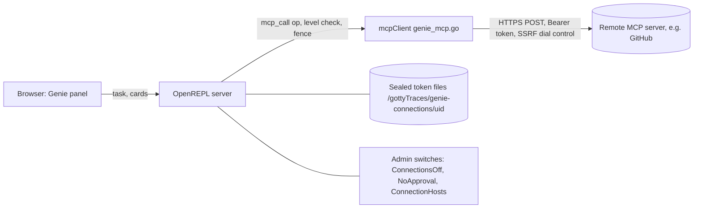
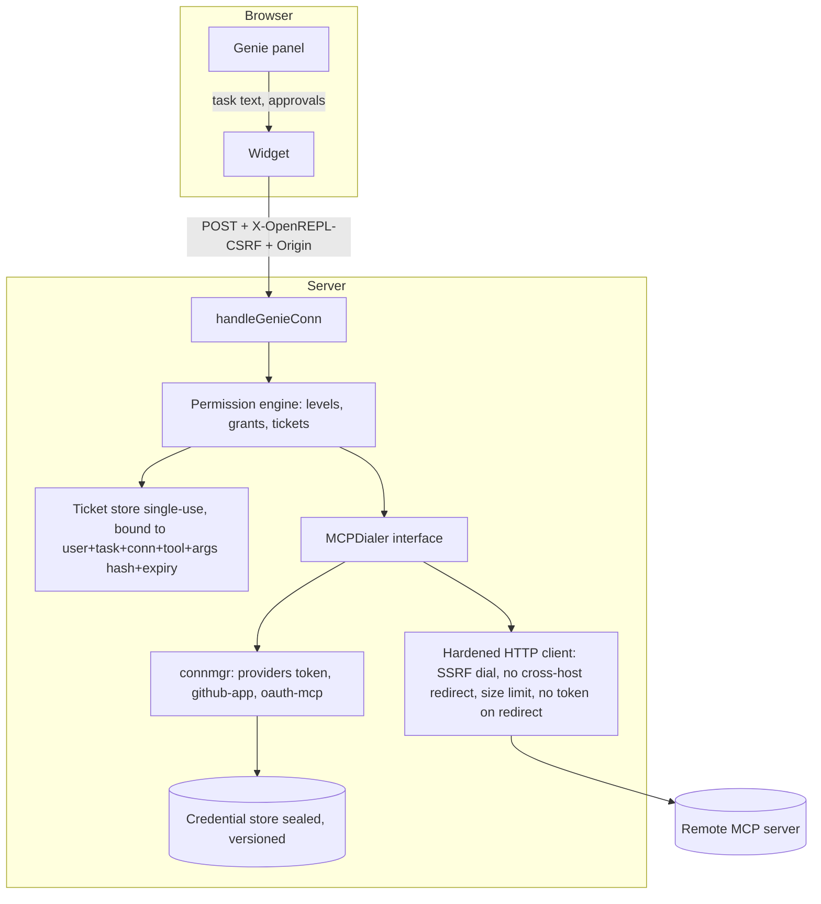

# OpenREPL MCP connections: architecture review, revision 2

Date: 2026-11-20. Replaces the first review (`mcp-architecture-review.md`). No code was changed.
Reviewed code: commit 6a5c42c3 (`src/server/genie_mcp.go`, `genie_conn.go`, `genie_conn_requests.go`, `genie_ext_fetch.go`, `chat-widget/src/index.ts`, admin and tests).

**Labels used everywhere:** `[V]` verified in our code or by a run today. `[S]` verified in the SDK source or a published document. `[A]` assumption. `[X]` needs an experiment before it is relied on.

## Status after the build (2026-11-20, night)

Phases 0 to 3 of the plan below were built the same night (uncommitted); see LLD 19 section 24a. Corrections to this review found while building:
- Section 2 and the retained findings say pagination is ignored and non-text content is dropped silently. **Wrong:** the client already followed `nextCursor` (up to 5 pages) and wrote `[image left out]` for other content. Only the 5-page cap and the missing "truncated" message were open.
- Section 5, T5/T6: the dial control already checks the dialed IP (so DNS rebinding is covered); only the cross-host redirect refusal was missing, now added.
- The plan was shortened as agreed in chat: no central credential store and no compare-and-swap for several gateways (one gateway); refresh is a per-connection single-flight mutex inside the sign-in phase. Numbering used when building: 0 hardening, 1 interface and discover, 2 GitHub App sign-in with refresh, 3 generic OAuth provider (data-driven, GitHub is the first entry).
- **Built:** tickets and grants kept by the server (`confirmed` ignored), same-origin check, argument check against the tool's schema, tool digest, annotations cannot lower a link's tool, redirect refusal, changed-address refusal, `mcpSession`/`dialMCP`, discover-first with initialize fallback, `DELETE` on close, `oauthDef` with PKCE, state, RFC 9207 issuer check, single-flight rotation-safe refresh, "Sign in with GitHub" button.
- **Not built / not verified:** the task grant for multi-step workflows after outside text (the server refuses a grant then), MCP endpoint discovery and client registration, a real 2026-07-28 server, real GitHub (`ghu_` accepted by the MCP endpoint? tool permissions), cookie SameSite, several gateways, the browser spec run (needs the CI's Firebase emulator).

## 0. What changed since revision 1

| # | Revision 1 said | Revision 2 says | Why |
|---|---|---|---|
| 1 | Adopt go-sdk (1.7.0) for the protocol | **Do not adopt it now.** Put our thin client behind an `MCPSession` interface; adopt the SDK only when a Go >= 1.25 toolchain is justified on its own | `[V]` go-sdk v1.8.0 `go.mod` says `go 1.25.0`. Our build is Go 1.23.12 with `GO111MODULE=off` and GOPATH. v1.0 to v1.3 need 1.23, v1.4 needs 1.24, v1.5 to v1.8 need 1.25. The versions that build here have no auth package and no 2026-07-28 support |
| 2 | Review against 2025-06-18 | Review against 2026-07-28 and keep 2025-06-18 working | Section 2 |
| 3 | Tool-call `confirmed` flag, taint guard | Replace `confirmed` with single-use server tickets; split data taint from user authorization | Sections 5 and 6 |
| 4 | Priority: SDK, then OAuth | Security hardening first, then central credential store and the interface, then GitHub OAuth, then generic OAuth | Section 9 |

## 1. Current architecture (verified)



`[V]` facts that matter for the rest of this document:
- One new MCP session per call: `initialize`, `notifications/initialized`, the call, no `DELETE`. Always sends header `MCP-Protocol-Version: 2025-06-18`, ignores the initialize result (no version negotiation, no capability check).
- Text content only; other content types are dropped. `tools/list` is read without following `nextCursor`.
- Tokens are sealed with AES-GCM, AAD `genie-conn:<uid>:<id>`, one file per user. A pasted token (PAT) is the only credential type.
- Levels: catalogue override, else server annotations, else `write`. Results are fenced as outside text. Limits: 20 calls per task, 6000 chars, 30 s, 8 connections per user, 60 calls/min.
- The taint guard marks any result as outside content, so a session-allowed write holds only for the first call of a task.
- The browser sends `confirmed: true` and the server trusts it. `[V]` This is the weakest point (section 5).
- SSRF: dial control with `publicIP`, test switch `extAllowLoopback`.

## 2. Spec compliance against MCP 2026-07-28 (and 2025-06-18)

Sources `[S]`: modelcontextprotocol.io specification pages for both revisions, the go-sdk v1.8.0 source (client.go, streamable.go, transport.go), and release notes. The cancellation row is the one point I could not confirm in the official changelog.

| Area | 2025-06-18 | 2026-07-28 | Our client today | Recommendation |
|---|---|---|---|---|
| Start-up | `initialize` then `notifications/initialized` | Initialize and sessions removed; client calls `server/discover` and each request carries what it needs | Always initialize; ignores the result | Try `server/discover` first, fall back to `initialize` on a JSON-RPC error or non-JSON answer. `[V]` the SDK does exactly this (run today: discover, then initialize, negotiated 2025-06-18 against an old server) |
| Version header | `MCP-Protocol-Version` after init | Same, plus `Mcp-Method` and `Mcp-Name` request headers | Fixed 2025-06-18 | Send the negotiated version. Add `Mcp-Method` and `Mcp-Name` when the server answered discover |
| Sessions | Optional `Mcp-Session-Id` | Removed | New session per call, never closed | Per-call is still correct for both; send `DELETE` when a session id was issued, to be a good citizen |
| GET stream | Optional server-to-client stream | No standing channel | We never open it | Keep it off. The SDK needs `DisableStandaloneSSE: true` `[V]` |
| Change notifications | `notifications/tools/list_changed` over the GET stream | Subscription model, optional | Not used | Not needed: we list tools per call. Re-list on every connect and invalidate cached descriptions by digest |
| Cancellation | `notifications/cancelled` | Reworked `[X]` | Cancel by dropping the HTTP request (context timeout) | Keep context cancellation; verify the 2026 semantics before sending explicit cancel messages |
| Pagination | `nextCursor` | Same | **Ignored: tools beyond page 1 are lost** `[V]` | Follow `nextCursor` up to a cap (for example 10 pages, 500 tools) and say when truncated |
| Content types | text, image, audio, resource, resource_link, structured | Same, plus MRTR (multi round-trip requests) | Text only | Keep only text; render other parts as a one-line placeholder ("image, 14 KB, not shown") instead of silently dropping them |
| Auth | OAuth 2.1, protected resource metadata, DCR | RFC 9207 issuer check, client metadata documents preferred over DCR, hardening | Static bearer only | Out of scope for phase 1; shapes phase 3 and 4 |

## 3. go-sdk v1.8.0 evaluation

| Question | Finding | Label |
|---|---|---|
| Builds on Go 1.23 / GOPATH? | **No.** `go 1.25.0` in `go.mod`; needs module mode. Older releases that do build (<= v1.3.0) lack the auth packages and 2026-07-28 | `[V]` |
| Custom HTTP transport | Yes: `StreamableClientTransport.HTTPClient`. Our SSRF dialer and a bearer `RoundTripper` can be injected | `[V]` run today |
| Bearer injection | Works through a `RoundTripper` (run today: every request carried `Authorization: Bearer tok-1`, including discover, initialize and DELETE). `auth.OAuthHandler` exists for the OAuth path | `[V]` / `[S]` |
| Session behavior | Discover first, fall back to initialize, then `Mcp-Session-Id` header and `DELETE` on close. Negotiated version reported by `InitializeResult()` | `[V]` run today |
| Response-size limits | `MaxEventSize` bounds one SSE event only. Plain JSON bodies need our own wrapper; run today with an `io.LimitReader` body wrapper in the RoundTripper | `[V]` |
| Pagination | `cs.Tools(ctx, nil)` iterator follows cursors | `[V]` |
| Non-text content | `Content` is a typed slice; we can render each | `[S]` |
| Compatibility through the SDK | Old and new servers both worked in the spike (only the old-server case was run) | `[V]` old, `[X]` new |

**Decision:** keep our client, behind an interface; revisit the SDK when the project moves to Go >= 1.25 for another reason. Putting the SDK in a separate Go module (a sidecar process) would solve the build problem but adds a process, a protocol between the two and a second place for secrets: not worth it for one remote HTTP protocol.

```go
// package genie, file genie_mcp_iface.go (new)
type MCPSession interface {
    Tools(ctx context.Context) ([]MCPTool, bool /*truncated*/, error)
    Call(ctx context.Context, name string, args map[string]any) (MCPResult, error)
    Close(ctx context.Context) error
}
type MCPDialer interface{ Open(ctx context.Context, c Connection, tok TokenSource) (MCPSession, error) }
```
`mcpClient` becomes the first `MCPDialer`; a go-sdk dialer can be added later without touching `genie_conn.go`.

## 4. Revised architecture



`connmgr` is **not** built first. It starts as the existing sealed token file behind a `TokenSource` interface (`Get(ctx) (token, expiry)`), so security work and OAuth work do not block each other.

## 5. Threat model (revised)

| # | Threat | Today `[V]` | Fix | Phase |
|---|---|---|---|---|
| T1 | Cross-site request makes the user's browser call `/genie/conn` | Cookie auth; no CSRF header or Origin check on this endpoint `[X]` SameSite value not measured | Require custom header `X-OpenREPL-CSRF` (value from the session) and check `Origin` against the site's host on every state-changing connection op | 0 |
| T2 | Client claims `confirmed: true` for a write | Server trusts it | **Single-use ticket**: server issues it when it shows the approval card; stored server-side bound to user, task, connection id, tool name, SHA-256 of canonical arguments, expiry (2 min). `call` consumes it atomically; any mismatch is refused. A resumed or edited call needs a new ticket | 0 |
| T3 | Remote tool descriptions, schemas, annotations lie (for example `readOnlyHint` on a delete) | Annotations decide the level when the catalogue has no override; descriptions go to the model (clipped to 160) | Treat all of it as untrusted: levels come from our catalogue first; for unknown tools default to `write` and **ignore annotations that lower the level**; annotations may only raise it. Escape and fence descriptions; hash the tool list and re-approve when the digest changes (stale approval invalidation) | 0 |
| T4 | Model supplies arguments the user never saw | Arguments pass through | Validate arguments server-side against the tool's schema (type, required, size cap) and show the exact arguments on the approval card; the ticket binds their hash | 0 |
| T5 | DNS rebinding / SSRF | `publicIP` dial control `[V]` | Keep; resolve once and dial the checked IP; re-check on every redirect hop; keep the loopback test switch out of production builds | 0 |
| T6 | Cross-host redirect sends the bearer token elsewhere | Not tested `[X]` | `CheckRedirect` refuses any redirect that changes host or downgrades scheme; the Authorization header is never copied (Go strips it on host change, but we also refuse) | 0 |
| T7 | Token leaks into logs, errors, the model, tool results | Sealed at rest; call log content `[X]` audit | Redact `Authorization` and token strings in every log and error; unit test greps logs after a call | 0 |
| T8 | Huge or endless response | 6000-char cut after reading the body `[X]` | Wrap the body in a limit reader (for example 1 MB) and stop reading SSE after the first result for our request id; 30 s deadline stays | 0 |
| T9 | Prompt injection through results | Fence plus taint guard `[V]` | Section 6 | 0/1 |
| T10 | Connection identity collision (two connections to the same server, or a renamed catalogue id) | Id is catalogue id `[A]` | Connection key = user + provider id + remote account id (or a random id) with the token AAD including that key | 1 |
| T11 | Refresh-token races (two requests refresh at once, one token is burned) | No refresh yet | Compare-and-swap on a credential version; single-flight per connection | 2 |
| T12 | Several gateways, one user | Files on one node's disk `[V]` | Credential store must be shared (object store with a version precondition) or pinned to one gateway; decide in phase 1 | 1 |

### Tickets (T2) in detail

```mermaid
sequenceDiagram
  participant M as Model
  participant S as Server
  participant B as Browser
  participant R as Remote MCP
  M->>S: wants create_issue(args)
  S->>S: level = write, no grant -> create ticket T (user,task,conn,tool,hash(args),exp)
  S->>B: approval card shows tool + exact args + ticket id
  B->>S: approve(ticket id)  [CSRF header + Origin]
  S->>S: mark ticket approved
  M->>S: call create_issue(args) with ticket id
  S->>S: atomically consume ticket; all fields must match
  S->>R: POST tools/call
```
Session-wide allow ("allow writes in this session") is a separate **grant** record, also server side, with user, session, connection, level and expiry; a grant never covers `irreversible`.

## 6. Taint, refined

Two separate ideas that the current code merges:
1. **Data taint**: the content came from outside (a remote result, a fetched page). It may be wrong or hostile. It never carries authority.
2. **User authorization**: the user (not the model, not a result) said yes to a specific action or a class of actions for a scope.

Rules:
- Tool output **never creates or widens authorization**. Only a ticket (one action) or a grant (a named class: connection + level + task or session + expiry) does, and both are created only from a browser request that passed T1.
- A multi-step workflow the user explicitly started ("triage my open issues and label them") may carry a **task grant**: connection, tools or level, max number of calls, expiry. Inside it, calls whose arguments the grant covers need no new card, **even after tainted reads**. A call outside the grant (other connection, higher level, other tool) always needs a card.
- After tainted data entered the context, any action **not covered by a grant** needs a ticket and the card must say "after reading outside content". This replaces today's behavior where one read makes a session-allowed write ask again.
- `irreversible` always needs a fresh ticket, with or without a grant.
- Grants and tickets are recorded in the call log, so the history shows which authorization allowed each call.
- `[X]` Measure on real tasks how often the card appears under the new rules, to see that it is not worse than today.

## 7. GitHub authorization

Primary interactive flow: **GitHub App with user authorization** (device or web flow). It gives a user-to-server token (`ghu_`), limited to what the user and the app installation can both do, expiring (8 h) with a refresh token. PAT stays as the fallback and for GitHub Enterprise Server (which needs a local stdio server, not the remote endpoint `[A]`).

| Token | Prefix | Acts as | Use here |
|---|---|---|---|
| User-to-server | `ghu_` | The user, within the app's permissions | Primary for interactive Genie |
| Installation | `ghs_` | The app itself | Not for user actions; only for webhooks and background jobs |
| Fine-grained PAT | `github_pat_` | The user, within chosen repos | Fallback |
| Classic PAT | `ghp_` | The user, broad scopes | Allowed but warn |

Things that must be verified with real calls before design is frozen `[X]`:
1. Does the remote GitHub MCP endpoint accept a `ghu_` token in `Authorization: Bearer`? Does it accept `ghs_`?
2. Which tools each token type can call; what error text a missing permission gives (so our card can explain it).
3. Does the endpoint publish OAuth protected-resource metadata we could use instead of a hand-written flow?
4. Rate-limit headers and whether they come back on MCP responses.
5. Refresh-token rotation: is the old refresh token invalid immediately?
6. Behavior on a repo the app is not installed on.

## 8. Retained findings from revision 1

- Identity collisions (T10), stale approval invalidation (T3 digest), non-text content and pagination truncation (section 2), refresh-token races (T11) and multi-gateway coordination (T12) all stay; each is placed in a phase below.
- Tool descriptions are clipped at 160 characters but not escaped; they enter the task note `[V]`. They are untrusted input (T3).

## 9. Phased plan (reordered)

### Phase 0: security hardening (before any new feature; small, mostly in existing files)

Files:
- `src/server/genie_conn.go`: ticket store, grants, argument validation, level rule (annotations only raise), tool-list digest, redaction.
- `src/server/genie_conn_requests.go`: CSRF header and Origin check on the routes.
- `src/server/genie_mcp.go`: hardened HTTP client (CheckRedirect, size limit), pagination, non-text placeholders, `DELETE` of a session.
- `src/server/genie_ext_fetch.go`: share `newExtClientFor` hardening (redirect rule, size limit).
- `chat-widget/src/index.ts`, `agent.ts`, `agent-protocol.ts`: card shows exact arguments, sends ticket id and CSRF header; stop sending `confirmed`.
- Tests: `genie_conn_test.go`, `genie_ext_test.go`, `e2e/tests/genie-connections.spec.js`.

Acceptance criteria and tests:
| Criterion | Test |
|---|---|
| A request without the CSRF header, or with a foreign Origin, is refused (403) on every connection op | Go test with `httptest`, table of ops x headers |
| `confirmed: true` in the body does nothing | Go test: write call with `confirmed` and no ticket returns "needs approval" |
| A ticket works once; second use refused | Go test, concurrent double use: exactly one succeeds |
| Ticket refused when user, task, connection, tool, args or expiry differ | Table test, one case per field |
| An annotation `readOnlyHint` on a tool our catalogue marks write does not lower the level; an unknown tool with `readOnlyHint` stays `write` | Go test |
| Arguments that violate the schema (type, required, over size) are refused before any network call | Go test with a fake server that fails the test if reached |
| Tool digest change invalidates a stored approval | Go test |
| A redirect to another host is refused and the token is not sent | Fake servers A and B; B records headers; assert none and an error |
| A DNS answer that flips from public to private is refused (rebinding) | Test resolver stub |
| Response over the cap stops being read | Server streams 100 MB; assert bytes read <= cap + one buffer and time bounded |
| Logs and errors never hold the token | Go test captures log output after success, 401 and a redirect |
| Pagination: 3 pages of tools all appear; a loop of cursors stops at the cap and says "truncated" | Fake server |
| Non-text content shows a placeholder | Fake server returns image + text |
| E2E: approval card shows exact arguments; approving once allows one call; the same call again asks again | Playwright |

Experiments in this phase `[X]`: measure the session cookie's SameSite; one real GitHub call with a PAT to confirm the hardened client still works.

### Phase 1: interface, credential store, protocol upgrade

- New `genie_mcp_iface.go` with `MCPSession`, `MCPDialer`, `TokenSource`.
- Protocol: discover first with initialize fallback; send negotiated version, `Mcp-Method`, `Mcp-Name`; read the initialize result (capabilities, version).
- Credential store with a connection key (T10) and a decision for multiple gateways (T12): shared object store with a version precondition, or per-user pinning.
- Refactor `genie_conn.go` to depend on the interfaces only.

| Criterion | Test |
|---|---|
| Against a fake 2025-06-18 server: discover fails, initialize works, version header is 2025-06-18 | Go test (matches the SDK spike run today) |
| Against a fake 2026-07-28 server: no initialize and no session id sent; `Mcp-Method` and `Mcp-Name` present | Go test `[X]` needs the final wire details |
| Existing behavior unchanged for the GitHub PAT flow | All current tests pass untouched |
| Two connections to one server do not share or overwrite credentials | Go test |
| Token file cannot be decrypted with another user's or connection's AAD | Go test |
| Credential update from two gateways: later version wins, a stale write is refused | Test with the store fake |

### Phase 2: central credential store with refresh

- Versioned records, single-flight refresh with compare-and-swap, failure state ("needs reconnect") shown in the panel.

| Criterion | Test |
|---|---|
| 50 concurrent calls with an expired token cause exactly one refresh | Go test with a counting fake token endpoint |
| A refresh that rotates the refresh token never leaves the store holding the old one (crash between steps simulated) | Fault-injection test |
| A revoked refresh token turns the connection to "reconnect needed", no retry loop | Go test |

### Phase 3: GitHub App user authorization

- Web or device flow, state and PKCE stored server side, callback route, `ghu_` token and refresh through phase 2, PAT fallback kept.
- Real-call experiments from section 7 first; their results may change this phase.

| Criterion | Test |
|---|---|
| State mismatch or reuse is refused | Go test |
| Callback with a different user's session is refused | Go test |
| After connect, a read tool works with the `ghu_` token | Real-call check against a test app and repo `[X]`, then recorded as a fake for CI |
| Disconnect removes the credential and revokes the grant where GitHub allows it | Go test + manual |

### Phase 4: generic OAuth providers

- `oauth-mcp` provider using protected resource metadata, issuer check (RFC 9207), client metadata documents where supported, DCR as fallback. Only when a second connector needs it.
- Re-evaluate the go-sdk here: if the toolchain moved to Go >= 1.25, `auth.OAuthHandler` may replace our flow code.

| Criterion | Test |
|---|---|
| Issuer mismatch in the authorization response is refused | Go test |
| Metadata fetch obeys the same SSRF and redirect rules | Go test |
| A second provider is added by data plus one provider struct, no change to `genie_conn.go` | Review of the diff |

## 10. What was verified today and what was not

Verified by running (`/tmp/sdkspike`, Go 1.25 toolchain, go-sdk v1.8.0, fake old-style server):
- Discover first, then initialize on failure; negotiated `2025-06-18`; session id carried; `DELETE` on close; `notifications/initialized` sent.
- Bearer token injected by a `RoundTripper` on every request.
- Tool list, schema, `readOnlyHint` and a call result decoded correctly.
- First attempt failed because the fake server answered `server/discover` with a non-JSON content type: the SDK treats that as a hard error rather than a fallback. `[V]` A real server that does this would break the SDK path; our own client should be tolerant here.

Not verified: 2026-07-28 behavior against a real 2026 server, cancellation semantics in the final text, real GitHub MCP with each token type, cookie SameSite, multi-gateway behavior.

## 11. Questions for the reviewing agent

1. Is the ticket binding (user, task, connection, tool, args hash, expiry) complete, or is something missing such as the model turn or the page origin?
2. Should a task grant (section 6) cover calls after tainted reads, or should tainted context always force a ticket for writes?
3. Is "annotations may only raise levels" too strict for connectors where the vendor's hints are reliable?
4. Is single-flight refresh with compare-and-swap enough on several gateways, or does the store need a lease?
5. Is deferring the SDK until Go >= 1.25 the right trade, or is a toolchain upgrade worth doing now?

## 12. Sources

- MCP specification, revision 2025-06-18 and 2026-07-28, transports and authorization pages (modelcontextprotocol.io).
- go-sdk v1.8.0 source and release notes (github.com/modelcontextprotocol/go-sdk): `mcp/client.go`, `mcp/streamable.go`, `mcp/transport.go`, `go.mod` per tag.
- GitHub documentation on GitHub Apps user access tokens, installation tokens and the remote GitHub MCP server.
- Local run: `/tmp/sdkspike` in container `openrepl-main-dev` (not in the repository).
